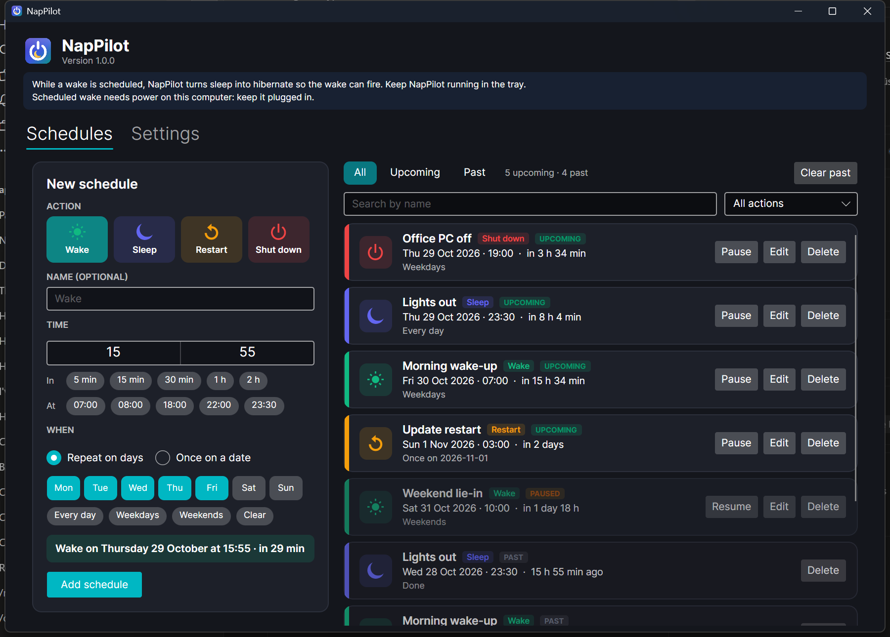

<div align="center">


# NapPilot

**Your computer's autopilot for shutdown, restart, sleep and wake.**<br>
Set it once and your PC or Mac turns off at night, wakes up before you do, and restarts when nobody is using it.

[](https://github.com/ugurpm/PowerPlan/releases/latest)
[](https://github.com/ugurpm/PowerPlan/releases)
[](https://github.com/ugurpm/PowerPlan/actions/workflows/ci.yml)


[-0078D4?style=for-the-badge&logo=windows11&logoColor=white)](https://github.com/ugurpm/PowerPlan/releases/latest/download/NapPilot-win-x64-Setup.exe)
[-111111?style=for-the-badge&logo=apple&logoColor=white)](https://github.com/ugurpm/PowerPlan/releases/latest/download/NapPilot-osx-arm64-Setup.pkg)

<sub>Other downloads (Windows on ARM, Intel Macs, portable zips) are in the [table below](#download).</sub>

<br>



</div>

## What it does

| | |
|---|---|
| ⏻ **Four actions** | Shut down, restart, sleep, and **wake** with the screen turned on. |
| 🗓️ **Any rhythm** | Once on a date, every day, weekdays, weekends, or any days you pick. Quick picks like *in 15 min* or *at 23:30*. |
| 🎨 **One clear list** | Upcoming and past schedules side by side, each action in its own colour. Filter by upcoming / past, by action, or search by name. |
| ✏️ **Edit, pause, delete** | Change any future schedule, pause it without losing it, delete it. Past runs can be deleted too, one by one or all at once. |
| 📜 **History** | Every run is recorded: done, skipped because the computer was off, or failed, and whether a wake really woke the computer. |
| 🛑 **No surprises** | A cancellable warning before every shutdown or restart. A shutdown that was missed while the computer was off **never** fires later. |
| 🌙 **Wake that works on modern laptops** | On Windows laptops with Modern Standby, timers cannot wake the PC from sleep. NapPilot turns sleep into hibernate while a wake is pending, so the wake fires. |
| 🔄 **Updates itself** | Downloads new versions in the background and installs them when you restart it. |
| 🔒 **Local and private** | No account, no cloud, no tracking. Schedules live in a JSON file on your computer. |

It sits in the tray (Windows) or the menu bar (macOS), can start when you sign in, and uses the system scheduler (Task Scheduler / launchd) so schedules run even when the window is closed.

## Download

| | Installer | Portable |
|---|---|---|
| **Windows** · Intel / AMD (most PCs) | [NapPilot-win-x64-Setup.exe](https://github.com/ugurpm/PowerPlan/releases/latest/download/NapPilot-win-x64-Setup.exe) | [zip](https://github.com/ugurpm/PowerPlan/releases/latest/download/NapPilot-win-x64-Portable.zip) |
| **Windows** · ARM (Snapdragon) | [NapPilot-win-arm64-Setup.exe](https://github.com/ugurpm/PowerPlan/releases/latest/download/NapPilot-win-arm64-Setup.exe) | [zip](https://github.com/ugurpm/PowerPlan/releases/latest/download/NapPilot-win-arm64-Portable.zip) |
| **macOS** · Apple silicon (M1 and later) | [NapPilot-osx-arm64-Setup.pkg](https://github.com/ugurpm/PowerPlan/releases/latest/download/NapPilot-osx-arm64-Setup.pkg) | [zip](https://github.com/ugurpm/PowerPlan/releases/latest/download/NapPilot-osx-arm64-Portable.zip) |
| **macOS** · Intel | [NapPilot-osx-x64-Setup.pkg](https://github.com/ugurpm/PowerPlan/releases/latest/download/NapPilot-osx-x64-Setup.pkg) | [zip](https://github.com/ugurpm/PowerPlan/releases/latest/download/NapPilot-osx-x64-Portable.zip) |

<details>
<summary><b>Which one do I need?</b></summary>

- **Windows:** open *Settings → System → About* and look at *System type*. "x64-based processor" → x64. "ARM-based processor" → ARM.
- **Mac:** open the Apple menu *→ About This Mac*. "Chip: Apple M…" → Apple silicon. "Processor: Intel…" → Intel.
</details>

<details>
<summary><b>"Windows protected your PC" / "Apple could not verify…"</b></summary>

The builds are not code-signed yet, so the first launch shows a warning.

- **Windows:** click **More info → Run anyway**.
- **macOS 15 and later:** try to open it once, then go to **System Settings → Privacy & Security** and click **Open Anyway**. On macOS 14 and earlier, right-click the app and choose **Open**.
</details>

<details>
<summary><b>Good to know</b></summary>

- **Wake needs power.** Many laptops only wake on a timer when plugged in. NapPilot shows a note when that applies.
- **Keep NapPilot running for wake.** Turn on *Settings → Start NapPilot in the tray when I sign in*.
- **Mac wake asks for your password.** macOS needs administrator rights to schedule a wake (`pmset`), so NapPilot asks once and schedules the next 30 days at a time.
- **Testing without risk:** *Settings → Dry-run* makes every schedule fire on time but only write to the log instead of turning anything off.
</details>

## Updates

Installed copies check GitHub for a new release every few hours, download it in the background and show **Restart to update**. If you quit instead, the update is installed on the way out. Nothing to do on your side.

## For developers

Built with **.NET 10**, **Avalonia 12**, CommunityToolkit.Mvvm and **Velopack**. Needs the .NET 10 SDK.

```bash
dotnet test
```

```bash
dotnet run --project src/PowerPlan.App
```

Debug builds start in **dry-run** (power actions are only logged). Release builds, which are what people install, do the real thing.

| Project | What it holds |
|---|---|
| `src/PowerPlan.Core` | Schedules, history, next-run calculation (DST-aware), validation, wake advice. No UI or OS code. |
| `src/PowerPlan.Platform.Windows` | Task Scheduler backend, power actions, capability probe, wake verification, sleep catcher, login item. |
| `src/PowerPlan.Platform.Mac` | launchd jobs, `pmset` wakes, power actions, login item. |
| `src/PowerPlan.App` | Avalonia window, tray icon, updater. `NapPilot --run <id>` runs one schedule headless. |
| `tests/*` | xUnit tests for Core and both platform layers. Nothing in them touches real power state. |

**Releasing:** bump nothing by hand, just push a version tag. The [release workflow](.github/workflows/release.yml) tests and packs all four builds and publishes the GitHub release that installed copies update from.

```bash
git tag v1.0.1
```

```bash
git push origin v1.0.1
```

More: [development guide](docs/DEVELOPMENT.md) · [roadmap](docs/ROADMAP.md) · [wake findings](docs/WAKE-FINDINGS.md)
